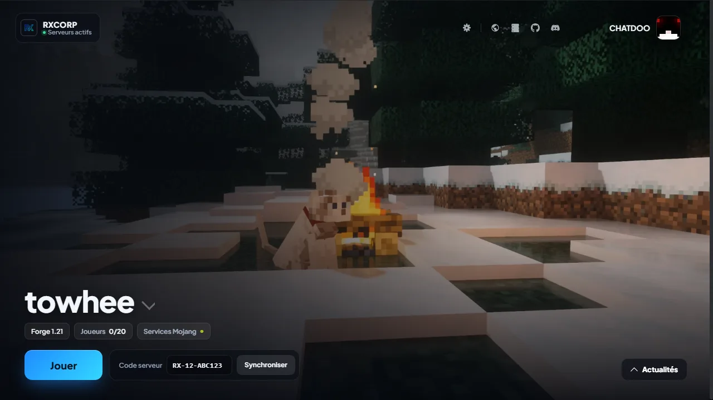
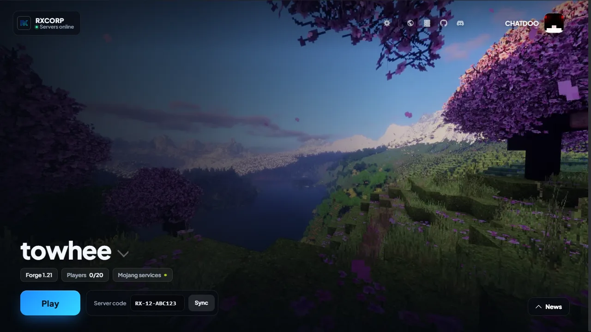
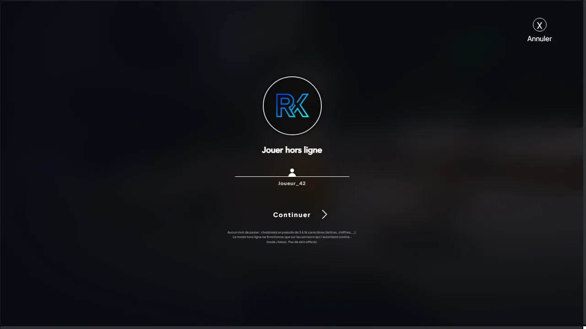
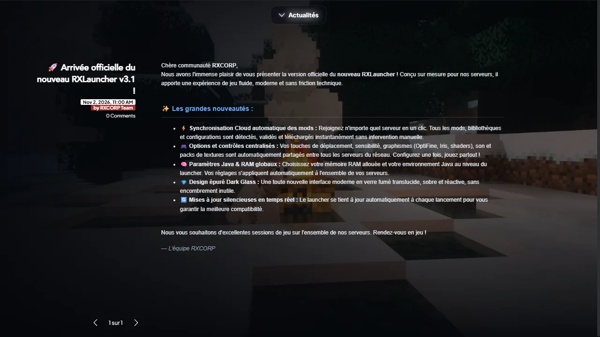

<p align="center"></p>

<h1 align="center">RXLauncher</h1>

<p align="center">Le launcher Minecraft des serveurs RXCORP.<br>Un code serveur, un clic sur Jouer : les mods, le modloader et Java s'installent tout seuls.</p>

<p align="center">
  <a href="https://rxcorp.me/launcher/">Télécharger</a> ·
  <a href="https://panel.rxcorp.me">Panel</a> ·
  <a href="https://github.com/CHATDOO/rxlauncher/actions/workflows/build.yml">Builds</a>
</p>



## Ce que fait le launcher

- **Accès par code** : chaque serveur a son code (`RX-12-ABC123`), affiché dans le panel. Sans code, le serveur est invisible et ses mods ne sont pas téléchargeables.
- **Mods synchronisés** : la liste des mods vient du dossier `/mods` du serveur. Seuls les mods manquants sont téléchargés.
- **Forge, NeoForge et Fabric**, avec la bonne version de Java installée automatiquement.
- **Comptes** Microsoft, ou hors ligne avec un simple pseudo (serveurs en `online-mode=false`).
- **Langue** : français ou anglais selon la langue de Windows.
- **Fond vidéo** piloté depuis le panel, mis en pause pendant le jeu.
- **Mises à jour automatiques** sous Windows et Linux.

| Accueil (anglais) | Hors ligne | Actualités |
|---|---|---|
|  |  |  |

## Plateformes

| Système | Fichier | Mise à jour auto |
|---|---|---|
| Windows 10/11 x64 | `RXLauncher-setup-x.y.z.exe`, portable `.exe`, `.zip` | Oui |
| Linux x64 | `RXLauncher-setup-x.y.z.AppImage` | Oui |
| macOS (Intel et Apple Silicon) | `.dmg` | Non (app non signée) |

Les binaires ne sont pas signés : Windows SmartScreen affiche « Éditeur inconnu », et macOS demande un clic droit > Ouvrir au premier lancement.

## Développement

Node 22 recommandé.

```bash
npm install        # applique aussi scripts/patch-helios.js (correctif détection Java)
npm start          # lance le launcher en mode développement
```

Fichiers utiles :

| Chemin | Rôle |
|---|---|
| `app/landing.ejs`, `app/assets/css/rx4.css` | Écran principal et thème RXCORP |
| `app/assets/js/scripts/rx-backdrop.js` | Fond animé (images + vidéo du panel) |
| `app/assets/js/skinhead.js` | Têtes de skin depuis l'API Mojang |
| `app/assets/js/distromanager.js` | Distribution par code serveur, nettoyage des serveurs sans code valide |
| `app/assets/lang/_custom_fr.toml`, `_custom_en.toml` | Textes RXCORP (FR / EN) |
| `scripts/patch-helios.js` | Patch postinstall de helios-core |

## Publier une version

1. Monter la version dans `package.json`, committer.
2. Pousser un tag : `git tag v3.4.0 && git push origin v3.4.0`.
   Le workflow **Build RXLauncher** compile macOS, Linux et Windows (environ 7 minutes).
   Il peut aussi être lancé à la main depuis l'onglet Actions.
3. Récupérer les artefacts du workflow et les publier sur `rxcorp.me` :
   - `launcher/update/` : installateur, `.blockmap` et `latest.yml` / `latest-linux.yml` en dernier ;
   - racine du site : `RXLauncher.exe`, `RXLauncher-Portable.exe`, `RXCORP-Launcher-Portable.zip`.

## Côté panel

| URL | Rôle |
|---|---|
| `GET panel.rxcorp.me/api/launcher/distribution/{code}` | Distribution Helios du serveur (404 si code invalide, limité à 30 essais/min) |
| `GET panel.rxcorp.me/api/launcher/server-mods/{id}/{mod}?code=` | Téléchargement d'un mod (403 sans le bon code) |
| `panel.rxcorp.me/launcher-bg/manifest.json` | Vidéos de fond (`{"videos":[{"file","sha256"}]}`) |
| `rxcorp.me/launcher/update/latest.yml` | Flux de mise à jour automatique |

## Crédits

Basé sur [Helios Launcher](https://github.com/dscalzi/HeliosLauncher) de Daniel Scalzi, sous licence MIT (voir `LICENSE.txt`).
